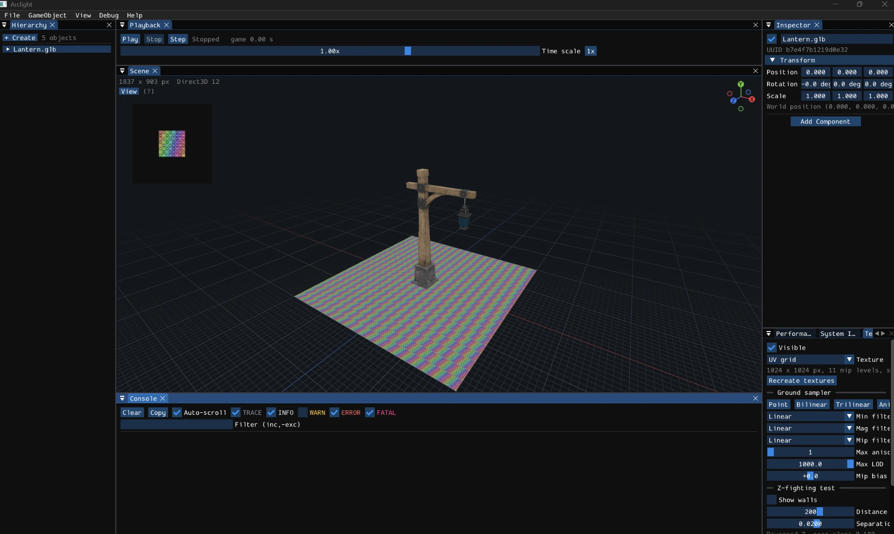
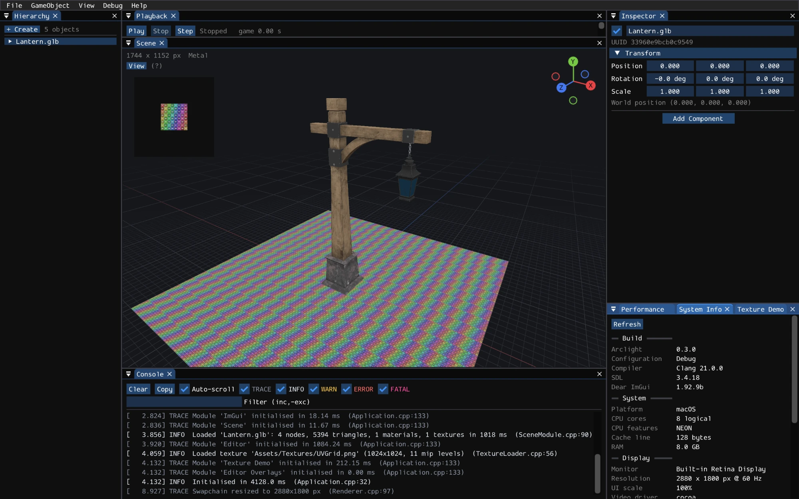
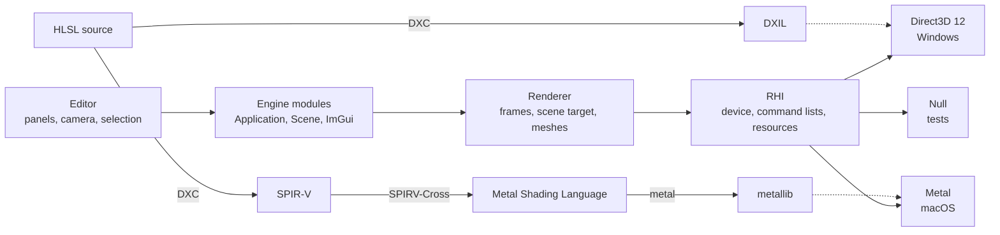

# Arclight

A cross-platform C++20 game engine and editor with Direct3D 12 and Metal backends behind one rendering interface.

A personal project, started in 2026 alongside my MSc in Advanced Programming for AAA Games at UPC Barcelona.

[](https://github.com/Anand-Ramnarain-27/arclight-engine/actions/workflows/ci.yml)
<!-- Add once a release is published (the badge reads "no releases" while releases are drafts):
[](https://github.com/Anand-Ramnarain-27/arclight-engine/releases/latest)
-->
[](LICENSE)
[](#platform-status)



<details>
<summary>The same scene on macOS (Metal, Apple M1)</summary>



</details>

## Highlights

- **One renderer, two graphics APIs.** A thin rendering hardware interface (RHI) with a Direct3D 12 backend on Windows, a Metal backend on macOS, and a Null backend that runs the unit tests without a GPU. ([Engine/Source/RHI](Engine/Source/RHI))
- **Write shaders once.** Each HLSL shader is compiled at build time to DXIL for Direct3D 12 and, through SPIR-V and SPIRV-Cross, to a Metal library. ([cmake/ArclightShaders.cmake](cmake/ArclightShaders.cmake))
- **Safe GPU resource lifetimes.** Two frames in flight, a per-frame upload ring for shader constants, and generational handles with fence-based deferred release, so resources can be replaced while the GPU is still using them. ([RHI/DeferredRelease.h](Engine/Source/RHI/DeferredRelease.h), [RHI/UploadRing.h](Engine/Source/RHI/UploadRing.h), [Core/Handle.h](Engine/Source/Core/Handle.h))
- **Editor viewport.** The scene renders to a texture shown in a dockable panel, with a fly/orbit/pan camera, reversed-Z depth with an infinite far plane, and an anti-aliased infinite grid. ([Editor/Source/Panels/ScenePanel.cpp](Editor/Source/Panels/ScenePanel.cpp), [Engine/Shaders/Grid.hlsl](Engine/Shaders/Grid.hlsl))
- **glTF 2.0 import.** Sparse accessors, triangle strips and fans, alpha modes, double-sided and mirrored meshes, with every offset and index bounds-checked, because model files are untrusted input. ([Renderer/GltfImporter.cpp](Engine/Source/Renderer/GltfImporter.cpp))
- **Scene and editor tooling.** GameObjects with components in a transform hierarchy, edited through Hierarchy and Inspector panels. ([Engine/Source/Scene](Engine/Source/Scene), [Editor/Source/Panels](Editor/Source/Panels))
- **Reproducible builds.** CMake presets, pinned dependencies, 78 unit test cases with doctest, and GitHub Actions building, testing and packaging both platforms. ([CMakePresets.json](CMakePresets.json), [.github/workflows](.github/workflows))

## Platform status

| Feature | Windows (Direct3D 12) | macOS (Metal) |
|---|---|---|
| CMake build, tests and release packaging | Working | Working |
| Window, input and frame timing (SDL3) | Working | Working |
| Dockable editor (Dear ImGui) | Working | Working |
| RHI: device, swapchain, buffers, pipelines | Working | Working |
| Build-time shader compilation | Working (DXIL) | Working (metallib) |
| Graphics API validation | Working (D3D12 debug layer) | Working (Metal API validation) |
| In-app GPU frame capture | Working (RenderDoc, PIX) | Working (Xcode) |
| Textures, samplers and mipmaps | Working | Working |
| Resource lifetimes and constants ring buffer | Working | Working |
| Scene viewport, editor camera, reversed-Z, grid | Working | Working |
| glTF 2.0 model import | Working | Working |
| Scene, Hierarchy and Inspector | Working | Working |
| Mouse picking and gizmos | Planned | Planned |
| Physically based lighting and shadows | Planned | Planned |
| Stylized rendering (toon, ink, pixel art) | Planned | Planned |

## Architecture



The editor and engine systems are modules that the application initialises in order and shuts down in reverse. Everything that touches the GPU goes through the RHI, so no engine header includes a graphics API.

- **A thin RHI shaped like Metal.** Render passes are explicit, with load and store actions, because that is the stricter of the two APIs: the Direct3D 12 backend can emulate a pass cheaply, but Metal cannot work without one. Resource states and barriers follow Direct3D 12, and Metal, which tracks hazards itself, only records them, so the same rules are checked on both platforms.
- **HLSL everywhere.** Shaders are written once in HLSL. DXC produces DXIL for Direct3D 12, and SPIR-V that SPIRV-Cross turns into Metal Shading Language, keeping HLSL register numbers as Metal binding indices. Everything is compiled at build time, so a shader error is a build error.
- **One set of conventions.** Right-handed, +Y up, column vectors stored column-major, radians, and counter-clockwise front faces. These match glTF, HLSL constant buffers and Metal's `float4x4`, so models and matrices need no conversion ([Math/Math.h](Engine/Source/Math/Math.h)).
- **Reversed-Z by default.** Depth is stored as 1 at the near plane and 0 at infinity, which spreads floating-point precision almost evenly with distance and greatly reduces z-fighting on distant geometry. It can be switched off in the Scene panel's camera settings to compare, using the z-fighting test in the Texture Demo panel.

## Building

### Prerequisites

| | Windows | macOS |
|---|---|---|
| OS | Windows 10/11, x64, a Direct3D 12 GPU | macOS 14+ on Apple silicon |
| Toolchain | Visual Studio 2022 with *Desktop development with C++* | Xcode 15+ with the Metal toolchain (`xcodebuild -downloadComponent MetalToolchain` if CMake reports it missing) |
| Shader compiler | Downloaded automatically (DXC) | [Vulkan SDK](https://vulkan.lunarg.com/sdk/home#mac), which provides DXC. Install it to `~/VulkanSDK`, or configure from a terminal where `VULKAN_SDK` is set |
| Other | CMake 3.25+ and Git. For debug builds, the *Graphics Tools* optional Windows feature (Direct3D 12 debug layer) | CMake 3.25+ (`brew install cmake`) and Git |

The first configure downloads every dependency at a pinned version, so it needs an internet connection.

### Windows

```bash
cmake --preset windows-vs2022
```
```bash
cmake --build --preset windows-debug
```

Or open `build/windows-vs2022/Arclight.sln` in Visual Studio and press F5.

### macOS

```bash
cmake --preset macos-xcode
```
```bash
cmake --build --preset macos-debug
```

Or open `build/macos-xcode/Arclight.xcodeproj`, pick the `Arclight` scheme and run. The generated scheme enables Metal API validation and GPU frame capture.

### Release build and package

One command configures, builds, runs the tests and writes a zip to `build/packages/`:

```bash
cmake --workflow --preset windows-release
```
```bash
cmake --workflow --preset macos-release
```

Prebuilt zips are attached to [Releases](https://github.com/Anand-Ramnarain-27/arclight-engine/releases).

## Using the editor

The sample *Lantern* model opens at start-up. To import another model, choose **File > Import Model** and enter the path of a `.gltf` or `.glb` file, or drag the file onto the window.

### Scene view (pointer over the Scene panel)

| Control | Action |
|---|---|
| Right drag | Look around |
| Right drag + W A S D | Fly; Q / E move down / up; hold Shift for 4x speed |
| Right drag + mouse wheel | Change the fly speed |
| Alt + left drag | Orbit around the focus point |
| Middle drag, or Alt + Shift + left drag | Pan |
| Mouse wheel | Dolly toward or away from the focus point |
| F | Frame the selection (the origin if nothing is selected) |
| Click an axis end of the gizmo | View along that axis |

### Everywhere

| Shortcut | Action |
|---|---|
| Delete | Delete the selected object |
| Ctrl+D (Cmd+D on macOS) | Duplicate the selected object |
| F5 / Shift+F5 | Play or pause / stop the game clock |
| F6 | Step one frame |
| + / - / 0 | Double / halve / reset the time scale |
| F11 | Capture a GPU frame (when started from RenderDoc, with `--pix`, or from Xcode) |

In the Hierarchy panel, drag objects onto each other to reparent them, or between rows to reorder them; right-click for create, duplicate and delete. **View > Reset Layout** restores the default docking layout.

## Project layout

```
cmake/            Build helpers: dependencies, shader compilation, warnings, packaging
docs/             Roadmap, release process and release notes
Editor/Source/    The Arclight editor: panels, editor camera and grid
Engine/Shaders/   HLSL shaders, compiled at build time
Engine/Source/    The engine library: Core, Math, Platform, RHI, Renderer, Scene, UI
Game/             Working directory when run from an IDE, and the assets shipped with the editor
Tests/Source/     Unit tests (doctest)
```

## Testing and CI

Build, then run the tests with CTest:

```bash
ctest --preset windows-debug
```
```bash
ctest --preset macos-debug
```

The tests use the Null backend, so they need no GPU. Configure with `-DARCLIGHT_BUILD_TESTS=OFF` to skip them.

GitHub Actions runs two workflows:

- **[CI](.github/workflows/ci.yml)**, on every push to `main` and `phase-3` and on every pull request: configures, builds, tests and packages Windows and macOS, and keeps the zips as workflow artifacts.
- **[Release](.github/workflows/release.yml)**, on every `v*` tag: the same build, with both zips attached to a draft GitHub release. The steps are in [docs/RELEASING.md](docs/RELEASING.md).

## Roadmap

| | Milestone |
|---|---|
| ✔︎ | **Foundations** (0.1.0): build, window, input, timing, math, editor shell |
| ✔︎ | **Rendering hardware interface** (0.2.0): Direct3D 12 and Metal backends, shaders, pipelines, GPU capture |
| ✔︎ | **Meshes, textures, camera and viewport** (0.3.0): textures, resource lifetimes, scene viewport, editor camera, glTF |
| In progress | **Engine architecture**: scene and Hierarchy/Inspector (done); next, mouse picking and gizmos, then frustum culling, an asset pipeline and scene serialization |
| Planned | **Lighting and PBR**: lights, tone mapping, physically based materials, image-based lighting |
| Planned | **Advanced rendering**: shadows, deferred and Forward+ shading, post-processing |
| Planned | **Compute, VFX, animation and gameplay**: job system, Tracy profiling, particles, skinning, Jolt physics, navigation, audio |

Stylized rendering (toon/cel shading, ink and hatching, pixel art) is planned alongside PBR, as a second material model in the same scene. The full plan is in [docs/ROADMAP.md](docs/ROADMAP.md), and changes per version are in [CHANGELOG.md](CHANGELOG.md).

## Credits and licence

Arclight's code and assets are released under the [MIT License](LICENSE).

Third-party code, all downloaded by CMake at pinned versions:

| Library | Use | Licence |
|---|---|---|
| [SDL3](https://github.com/libsdl-org/SDL) | Window, events, input, file I/O | [zlib](https://github.com/libsdl-org/SDL/blob/main/LICENSE.txt) |
| [Dear ImGui](https://github.com/ocornut/imgui) (docking branch) | Editor UI | [MIT](https://github.com/ocornut/imgui/blob/master/LICENSE.txt) |
| [stb_image](https://github.com/nothings/stb) | PNG, JPEG, TGA and BMP decoding | [Public domain or MIT](https://github.com/nothings/stb/blob/master/LICENSE) |
| [tinygltf](https://github.com/syoyo/tinygltf) | glTF 2.0 parsing | [MIT](https://github.com/syoyo/tinygltf/blob/release/LICENSE) |
| [nlohmann/json](https://github.com/nlohmann/json) (included with tinygltf) | JSON parsing | [MIT](https://github.com/nlohmann/json/blob/develop/LICENSE.MIT) |
| [RenderDoc in-app API](https://github.com/baldurk/renderdoc) | GPU capture trigger (Windows, header only) | [MIT](https://github.com/baldurk/renderdoc/blob/v1.x/LICENSE.md) |
| [doctest](https://github.com/doctest/doctest) | Unit tests | [MIT](https://github.com/doctest/doctest/blob/master/LICENSE.txt) |
| [DirectX Shader Compiler](https://github.com/microsoft/DirectXShaderCompiler) | HLSL compiler (build tool) | [NCSA](https://github.com/microsoft/DirectXShaderCompiler/blob/main/LICENSE.TXT) |
| [SPIRV-Cross](https://github.com/KhronosGroup/SPIRV-Cross) | SPIR-V to Metal Shading Language (build tool, macOS) | [Apache 2.0](https://github.com/KhronosGroup/SPIRV-Cross/blob/main/LICENSE) |

The release zips include the licence notices of every library linked into the editor, in `ThirdPartyLicenses/`.

The *Lantern* sample model is from the [Khronos glTF Sample Assets](https://github.com/KhronosGroup/glTF-Sample-Assets/tree/main/Models/Lantern), by Microsoft, under [CC0 1.0](https://creativecommons.org/publicdomain/zero/1.0/).

## Author

**Anand Ramnarain**: [Portfolio](https://anand-ramnarain-27.github.io/Portfolio) · [LinkedIn](https://www.linkedin.com/in/anand-ramnarain-585096336)
